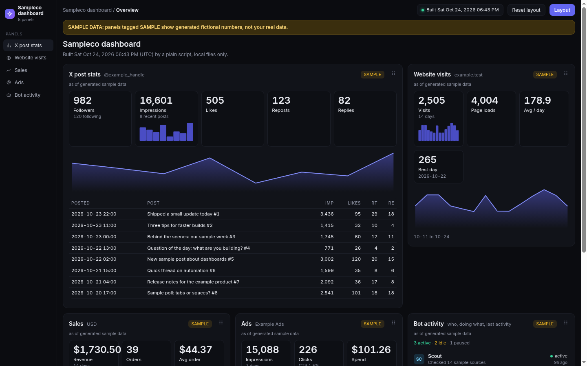
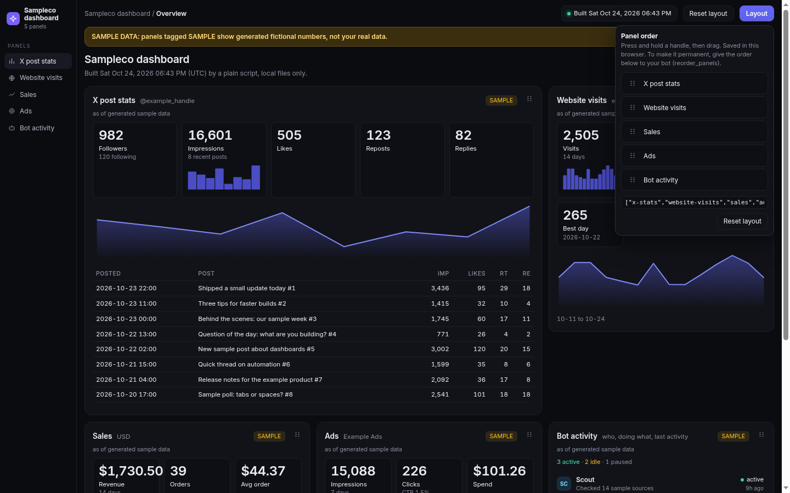
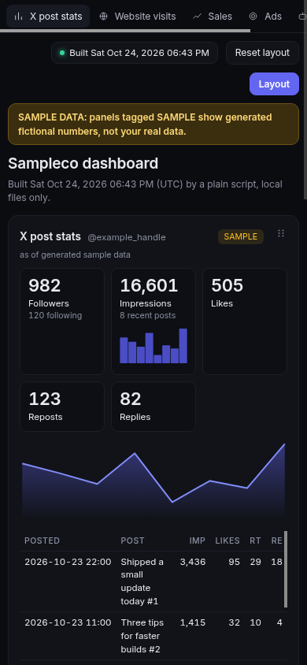

# agent-dashboard (Agent Plugin)

**Tell your bot "set up my dashboard" and get a private, drag-to-arrange dashboard on your own computer, with nothing to host and nothing to log in to.**

Refreshing your dashboard is a plain script: no model calls and no bot turns, about 0.05 s of CPU for a 5-panel build, and the idle server uses zero CPU. Your bot is only involved when you ask it to set up, add, move or open something, each one to three small tool calls (answers capped at 8 KB, never containing your data).


*Screenshots show built-in fictional sample data ("Sampleco") only.*

## Why you'll like it

- **One sentence to set up.** Say "set up my dashboard": one tool call creates sample panels, builds the page and opens it. You edit no files.
- **Drag to reorder.** Press and hold a card's grip, then drag; or just tell your bot "move sales to the top".
- **Local only.** One HTML file on your own computer. The page loads nothing from the network, and the plugin makes network calls only to `http_json` sources you configure.
- **No bot usage on refresh for file and endpoint panels.** A cron line running `scripts/build.py` keeps them current. Panels fed through one of your bot's own connectors need a bot turn per refresh.
- **No account for the plugin.** No sign-up, no login, no hosting. (A data source you connect may have its own login; that is yours.) Keys stay on your computer and a leak guard fails the build if one would end up in the page.
- **Sample data first.** Every panel starts with clearly tagged fictional numbers; you connect real data one panel at a time.

## How it works

1. **Install and say "set up my dashboard".** Your bot asks what you want to see (X stats, website visits, sales, ads, bot activity) and adds those panels with sample data through the plugin's tools.
2. **A plain script builds one HTML page** from the settings file (`out/dashboard.html` in your dashboard folder). Say "open my dashboard", or run `python3 scripts/build.py --open`, or put it on a cron schedule.
3. **Connect real data when you are ready:** an export file (`.json` or `.csv`), an https endpoint, or a connector your bot already has. See `docs/connect-a-source.md`.

Honest limits: setup puts about 2K tokens (estimated) of plugin text in front of your bot, once; panels fed through your bot's own connectors need a bot turn per refresh (use the file or endpoint route to avoid that); all numbers were measured on one VM. See `docs/usage-audit.md`.

<p> </p>

## Getting started (about one minute)

1. **Install** the plugin in your Grok Bot (see Install below). You need Python 3.9 or newer on your computer (see "If something fails" if you are not sure).
2. **Say these to your bot**, one at a time:

| you say | what happens |
|---|---|
| **"set up my dashboard"** | The bot asks what you want to see (X, website visits, sales, ads, your bots), creates everything for you with sample data, builds the page and opens it in your browser. You edit no files. |
| **"add my X stats"** | Adds (or connects) the X stats panel. It shows sample numbers, tagged SAMPLE, until you connect real data. |
| **"open my dashboard"** | Rebuilds the page and opens it again. Also: "show / refresh my dashboard". |
| **"move sales to the top"** | Reorders the panels. (You can also drag them yourself: press and hold the grip, then drag.) |
| "connect my sales to my dashboard" | Real data: your bot picks one of three ways (existing connector, a file, or an endpoint) and tells you where keys go. See `docs/connect-a-source.md`. |
| "remove the ads panel" | Removes a panel. |

Your dashboard lives in a hidden folder named `.agent-dashboard` in your home folder (set the `DASHBOARD_HOME` environment variable to use another folder). It is created automatically. The page is `out/dashboard.html` inside it.

## If something fails

**Python is missing** (the bot says the dashboard tool could not start, or `python3: command not found`). Install Python 3.9 or newer, then restart your bot:
- macOS: `brew install python` (or download from python.org/downloads)
- Windows: `winget install Python.Python.3.12` (or python.org/downloads, tick "Add python.exe to PATH"). Windows uses the command `python`, not `python3`: in `mcp.json` change `"command": "python3"` to `"command": "python"`.
- Linux: `sudo apt install python3` (Debian/Ubuntu) or `sudo dnf install python3` (Fedora)
- Check with: `python3 --version`

**A source is unreachable** ("could not reach the source"). Check your internet connection and that the URL is right, then say "refresh my dashboard". The other panels still work; only that panel shows an error card.

**A key is missing or wrong** ("environment variable NAME is not set", or "HTTP 401: the key was rejected"). Set the variable on your computer (or add a `NAME=your-key` line to `secrets.env` in the dashboard folder; details in `docs/connect-a-source.md`), restart your bot if you set it system-wide, then say "refresh my dashboard". For a rejected key, make a new read-only key at the service. Never paste keys into chat.

**The page is blank, or shows old numbers.**
1. Open `<dashboard folder>/out/dashboard.html` in a normal browser (Chrome, Safari, Firefox, Edge) with JavaScript on.
2. Say "refresh my dashboard". If a panel failed, its card shows the reason and a "Fix:" line.
3. No browser opens by itself on a computer without a screen: the bot gives you the file path to open by hand.
4. Still blank: run `python3 scripts/build.py` in the plugin folder; it prints what went wrong. To start over, say "set up my dashboard" again (it never overwrites what you have; it only adds missing panels). A damaged settings file is restored from `config.json.bak` (the bot tells you the exact step).

**Cannot write to the folder.** Set `DASHBOARD_HOME` to a folder you own and retry.

**How to refresh.** Say "refresh my dashboard" (or "open my dashboard"). To refresh on a schedule without your bot, add a cron line (macOS/Linux; on Windows use Task Scheduler with the same command): `*/30 * * * * python3 /path/to/plugin/scripts/build.py` (set `DASHBOARD_HOME` and your keys in that environment). Panels that read an export file refresh when that file is rewritten; panels tied to a connector refresh when you ask your bot.

**Local-first.** v1 builds a single HTML file on your own computer. No hosting, no accounts, no logins. API keys stay in environment variables on your machine and never end up in the HTML or `data.json`. Online or password-protected sharing is *future, not in v1* (it would be an opt-in extra).

- Panels you can drag to reorder (press and hold the grip, then drag). Order is saved in the browser (`localStorage`); the Layout menu shows the order as JSON so the bot can make it permanent.
- Ready-made panels: **X stats, website visits, sales, ads, bot activity**. Each has a sample-data generator and a documented shape for a real source.
- Zero dependencies: Python 3.9+ standard library only (no SDK, no pip, no CDN, no fonts, no network unless you configure an `http_json` source).
- Secrets live in environment variables on your computer and can never end up in the page: a **secret-leak guard** fails the build if a secret value shows up in the output.

## Data shape

```
DashboardConfig = { version: 1, title: string, secrets: [ENV_NAME], guard: { auto_env: bool }, panels: [Panel] }
Panel           = { id, type, title, source: Source, options: { span: 1|2, ...type options } }
  id      a-z 0-9 - _  (max 40, unique)           type   x_stats | website_visits | sales | ads | bot_activity
Source          = { mode: "sample" }
                | { mode: "file", path: "data/x.json" }                       (relative to the dashboard folder)
                | { mode: "http_json", url: "https://...", auth_env: "MY_TOKEN",   (NAME of an env var, never the value)
                    auth_header: "Authorization", auth_scheme: "Bearer", timeout: 10 }

DashboardData   = { meta: { title, built, tz, key, sample },
                    panels: [ { id, type, title, span, source_mode, asof, data | error } ] }      -> out/data.json and embedded in the page
```

`data` is the *display shape* of each panel type (validated and computed by the build: totals, CTR, CPC, stale flags). A `file` or `http_json` source returns the **raw shape** of the type (below). Anything invalid becomes an error card for that panel only; other panels still build.

### Panel library

| type | options (defaults) | raw shape a real source returns | typical real source (key in env only) |
|---|---|---|---|
| `x_stats` | `handle`, `max_posts` 8, `span` 2 | `{handle, followers, following, posts:[{time,text,impressions,likes,reposts,replies}]}` | X API v2 via your own cron script, bearer in `X_BEARER_TOKEN` |
| `website_visits` | `site`, `days` 14 | `{site, days:[{date,visits,page_loads?}]}` | Plausible / Cloudflare Web Analytics export, key in env |
| `sales` | `currency` USD, `days` 14 | `{currency, days:[{date,orders,revenue}], recent:[{date,item,amount}]}` | Stripe/Shopify export with a read-only key in env |
| `ads` | `platform`, `currency`, `days` 7 | `{platform, currency, days:[{date,impressions,clicks,spend}]}` | Google/Meta Ads reporting export, credentials in env |
| `bot_activity` | `max_items` 12, `stale_after_hours` 24 | `{bots:[{name,status:active/idle/paused,last_update:ISO,last_action}]}` | A status JSON your bots update (no credentials) |

`list_panel_library` returns exactly this, live, from the code. Example raw files are in `examples/data/` (fictional).

## Install

The plugin is a standard Agent Plugin (`plugin.json`, `mcp.json`, `skills/`). Install it from your client's plugin page once it is published (see `LISTING.md`), or, in the Cursor IDE, test it from a local folder (see `docs/TEST-INSTALL.md`). The MCP server runs `python3` on `server/mcp_server.py`; `mcp.json` locates the plugin folder through whichever of `${PLUGIN_ROOT}` (Agent Plugins standard) or `${CURSOR_PLUGIN_ROOT}` (Cursor) your client fills in, so it starts the same way in both. On Windows change `command` to `python`. The dashboard lives in `~/.agent-dashboard` unless you set `DASHBOARD_HOME` to another folder.

## Use

1. "Set up my dashboard" -> `setup-my-dashboard` skill: bot asks what you want, calls `setup` (folder + sample panels + build + open).
2. "Add sales to my dashboard" -> `add_panel {type:"sales"}` + `rebuild`. Starts in sample mode with a SAMPLE tag.
3. "Connect it to my store" -> the `add-dashboard-source` skill: three ways (existing connector, a JSON/CSV file, or an `http_json` endpoint); keys stay in an env var or `secrets.env` on your computer; the bot switches `source` with `update_panel`. See `docs/connect-a-source.md`.
4. "Move bot activity to the top" -> `reorder_panels`. "Remove ads" -> `remove_panel`.
5. "Open my dashboard" (or "show / refresh my dashboard") -> `open_dashboard`: rebuilds, then opens `<dashboard folder>/out/dashboard.html` in your default browser. Without a bot: `python3 scripts/build.py --open`. Refresh automatically with cron: `*/30 * * * * python3 /path/to/plugin/scripts/build.py` (set `DASHBOARD_HOME` and your env vars there). No bot turn involved.

### MCP tools

| tool | what it does |
|---|---|
| `setup {title?, panels?, no_open?}` | **first run in one call**: creates the folder and sample panels, builds, opens the page; safe to repeat (never overwrites) |
| `init {title?, panels?, force?}` | low-level: create the config seeded with sample panels |
| `list_panel_library {type?}` | panel types, options, raw shapes, real-source notes (pass `type` for just one: much smaller) |
| `list_panels` | current panels in order |
| `add_panel {type, id?, title?, source?, options?, position?}` | validate + add |
| `update_panel {id, title?, source?, options?}` | edit (options merge), e.g. sample -> file |
| `remove_panel {id}` / `reorder_panels {order}` | remove / set order (every id exactly once) |
| `open_dashboard {no_open?}` | rebuild, then open the page in the default browser (returns path + whether it opened; `no_open` for headless) |
| `rebuild` | run the build script: collect, normalize, leak-guard, write `out/dashboard.html` + `out/data.json` |

All 10 tools validate input, return `isError` results with a clear message (never a crash), and write the config atomically (temp file + `fsync` + `rename`, under a lock).

### Skills

- `setup-my-dashboard`: "set up my dashboard": asks what you want to see, calls `setup`, tells you what you are looking at (sample data) and what to say next.
- `manage-dashboard`: triggers on "open / show / refresh my dashboard" (calls `open_dashboard`) and turns "add X / remove Y / move Z" into tool calls and verifies the rebuild.
- `add-dashboard-source`: the three ways to connect real data (connector, file, endpoint), where keys go (env var or local `secrets.env`, never chat/HTML/`data.json`), read-only keys, verify output, keep sample mode. Companion doc: `docs/connect-a-source.md`.

## Usage (what this costs to run)

Measured on one Linux VM, details and method in `docs/usage-audit.md`:

- **Refreshing uses no model and no bot turn.** The build is a plain Python script. With the network switched off, `scripts/build.py` and the MCP `rebuild` / `open_dashboard` still succeed. A sample 5-panel build takes about 0.05 s of CPU and 22 MB of memory; the largest allowed build (20 panels, 2 MB files) takes about 0.16 s and 30 MB.
- **The MCP server does nothing while idle:** 1 thread, no timers, 0.00 s CPU over 45 s, no output.
- **The page never reaches the network** and has no auto-refresh. Its only timers are the local drag animation.
- **The bot is involved only when you ask it to do something.** Setup is 1 tool call (about 1.3 KB answer), "open my dashboard" is 1 call (under 1 KB), add or move is 2 calls. Setup puts about 2K tokens (estimated) of plugin text in front of the bot, once. That is small but not zero.
- **Limits that stop runaway cost:** 2 MB per source, 20 panels, 500 items per list, 10 s default request time limit (30 s max), 60 s per build, no automatic retries, and every tool answer is at most 8 KB and never contains your data or the page.
- **The exception: connector panels.** If a panel gets its data through one of your bot's own connectors, each refresh needs a bot turn. Use the file or endpoint route for refreshes that never involve a bot.

## Security model

- The config stores only the **names** of env vars (`auth_env`, `secrets`). Keys live in an environment variable or in the user's own `secrets.env` key file (`DASHBOARD_ENV_FILE` to move it); every name in that file is covered by the leak guard, and the build warns if the file is readable by other users. Tools reject values that look like keys and reject credentials in URLs.
- `file` sources must be relative paths inside the dashboard folder (no `..`, no absolute paths, no `secrets`/`.ssh`/`.env`-style folder names, symlinks out are refused). `http_json` is `GET` only, https (plain http only for localhost), 10 s default total time limit (1 to 30 s, counted across the whole request, so a slow drip is cut too), 2 MB cap, no automatic retries, **redirects are never followed**, and the URL/headers never appear in output or error text.
- **Leak guard** (`dashlib/build.py`): before anything is written, the exact bytes of `dashboard.html` and `data.json` are scanned for the *values* of every configured secret env var (`secrets[]` plus each `auth_env`) and, by default, every env var whose name contains KEY, TOKEN, SECRET, PASSWORD, PASSWD, CREDENTIAL or BEARER (switch off with `guard.auto_env:false`). Raw, HTML-escaped, JSON-escaped, URL-encoded and base64 forms are checked. A hit aborts the build with exit code 3 (`rebuild` returns an error), nothing new is written, and the message names the variable, never the value. The written files are re-scanned from disk as a second check.
- The page escapes every string (`E()`), embeds data with `<`, `>`, `&` encoded so data can't close the script tag, loads nothing from the network, and is tested against hostile data in a real browser.
- Limits: the guard can only catch secrets it knows about (set the env var, name it in `secrets` or `auth_env`). Short values (< 6 chars configured, < 8 auto-detected) are not scanned and are reported as such. Your export scripts are your code: keep keys out of what they write.

## Testing

```
python3 tests/test_all.py        # or tests/run.sh; exit 0 only if everything passes
UPDATE_SCREENSHOT=1 python3 tests/test_all.py   # also regenerate docs/preview-*.png (sample data only)
```

The suite covers: manifest validation against the Agent Plugins 1.0.0 JSON Schemas (`tests/schemas/`, uses `jsonschema` if installed, built-in checks otherwise); config validation and atomic edits; the MCP server over real stdio with scripted JSON-RPC (initialize, ping, tools/list, every tool, success and error paths, malformed input); sample build and HTML checks; headless Chrome render and hostile-data (XSS) check; a real-browser drag test over the DevTools protocol (press-and-hold, drag, localStorage persistence, reload, bad storage, reset) in `tests/drag_test.js`; `http_json` source against a local server (auth header, 401, missing env var, redirect refusal); the leak guard with a fake secret (leaking data aborts, CLI exit code 3, escaped variants, configured and auto-detected names, odd characters); a **brand-new-user run** in `tests/test_first_run.py` (empty home folder, scripted MCP session: setup, choose panels, build, open, add/reorder/remove, rebuild) with every failure path (unreachable endpoint, missing key, rejected key, corrupt settings, unwritable folder, unknown panel type, no browser, key file, CSV); **usage caps** in `tests/test_caps.py` (over-size files and responses, slow and slow-drip endpoints, no retries, build time budget, panel/config/row limits, tool answers at most 8 KB with huge sources, idle server CPU and threads, no timers or network code in the page); and a package-wide grep for personal/host terms and key patterns. `tests/measure_usage.py` re-measures the numbers in `docs/usage-audit.md`. Browser tests are skipped if Chrome/Node are absent. Needs Node 20+ with `--experimental-websocket` (or Node 22+) for the drag test.

Local-only proof: Grok Bot cannot load local plugins from `~/.cursor/plugins/local`, so what is proven here is the stdio protocol behaviour plus the schema validation of `plugin.json` and `mcp.json`, not an install through a client.

## Layout

```
plugin.json  mcp.json  README.md  PUBLISH-CHECKLIST.md
skills/setup-my-dashboard/  skills/manage-dashboard/  skills/add-dashboard-source/   (each has SKILL.md)
server/mcp_server.py               hand-rolled JSON-RPC stdio server, no SDK
dashlib/                           opener.py (open in browser), config.py (validate, atomic), library.py (panels), sources.py, build.py (+leak guard), template.html
scripts/build.py                   the plain rebuild script (cron-safe); --open also opens the page
examples/data/*.json               fictional raw-shape files    LISTING.md   tests/
docs/connect-a-source.md           how to connect real data and where keys go
docs/usage-audit.md                measured usage numbers, method, limits
docs/preview-*.png                 sample-data screenshots
```

## Known gaps

CSV files supply the list part only (rows), not top-level fields like follower count. No live data connectors are bundled (by design: you run a small export script or point at an endpoint that returns the raw shape). One dashboard per folder. Only the last N days a source provides are shown; no date-range picker. Not yet installed through a real client.

## Author, license, contact

By `howdyollie`. MIT license (see `LICENSE`). Source and issues: https://github.com/howdyollie/agent-dashboard (issues: https://github.com/howdyollie/agent-dashboard/issues).
